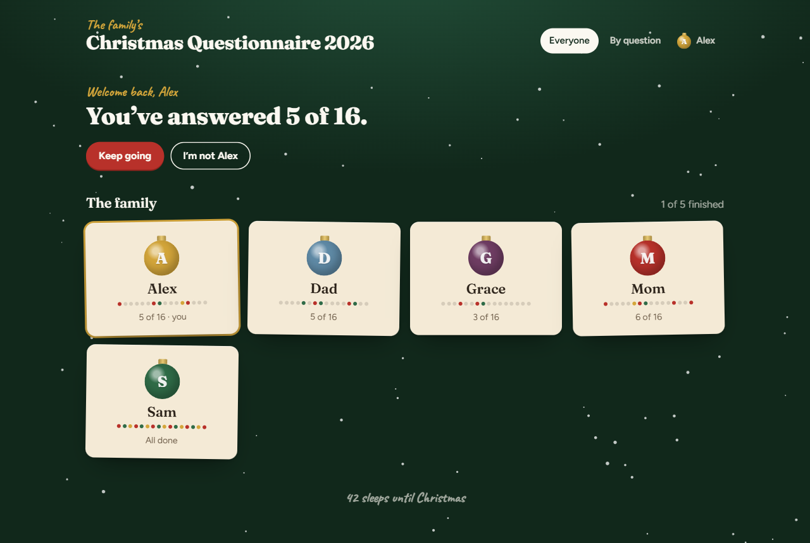
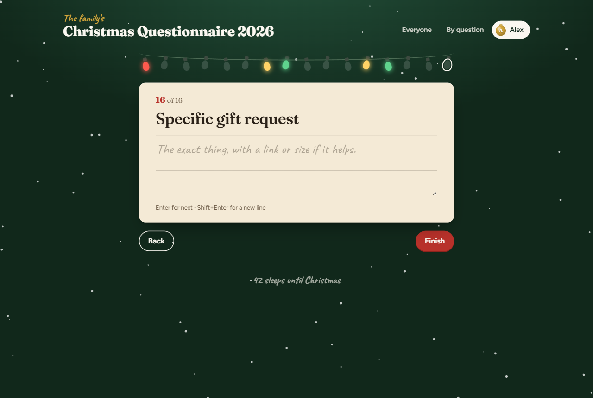
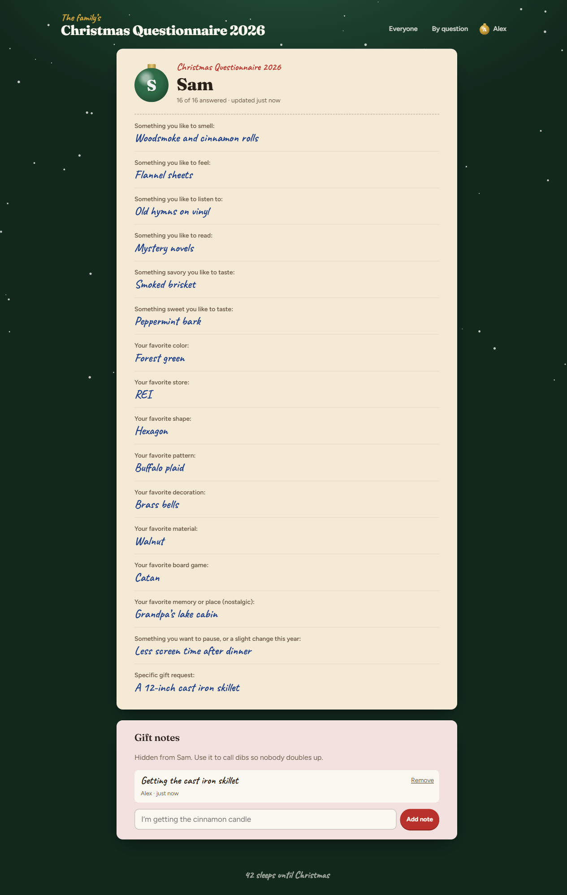
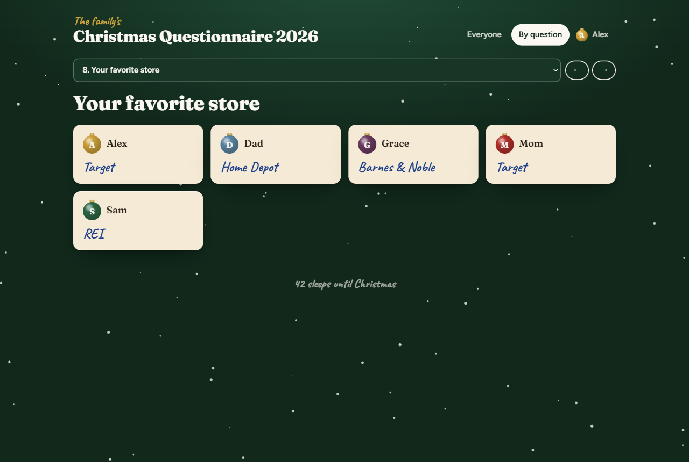

# Family Wishlist

A small, self-hosted Christmas questionnaire for your family. Everyone fills out the same set of questions (favorite smell, favorite store, a specific gift request, and so on), and everyone else can browse the answers when they're shopping.



- **One family code.** A 4 to 8 digit PIN keeps strangers out. No accounts, no emails, no passwords to forget.
- **One question at a time.** Answers save as you type. A string of Christmas lights fills in as you go.
- **Browse by person or by question.** See one person's whole card, or everyone's favorite store side by side.
- **Secret gift notes.** Leave a note on someone's card ("I'm getting the skillet") so nobody doubles up. The person it's about doesn't see it.
- **Your own questions.** Edit one JSON file to change the questions, hints and title.
- **Tiny.** One Node.js process, no npm dependencies, no database. Answers live in a single JSON file with daily backups.

| Fill out your card | Someone's card | By question |
| --- | --- | --- |
|  |  |  |

## Quick start

### Docker Compose

Create a folder with this `compose.yaml` (it's also in this repo):

```yaml
services:
  wishlist:
    image: ghcr.io/pcamp96/family-wishlist:latest
    container_name: family-wishlist
    restart: unless-stopped
    environment:
      PIN: "2468"   # The family code. 4 to 8 digits. Change it.
    ports:
      - "8080:8080"
    volumes:
      - ./data:/data
```

Then:

```sh
docker compose up -d
```

Open `http://<your-server>:8080` and enter the code.

### Docker CLI

```sh
docker run -d \
  --name family-wishlist \
  --restart unless-stopped \
  -p 8080:8080 \
  -e PIN=2468 \
  -v "$(pwd)/data:/data" \
  ghcr.io/pcamp96/family-wishlist:latest
```

### Build it yourself

```sh
git clone https://github.com/pcamp96/family-wishlist.git
cd family-wishlist
docker build -t family-wishlist .
docker run -d --name family-wishlist -p 8080:8080 -e PIN=2468 -v "$(pwd)/data:/data" family-wishlist
```

Or without Docker (Node.js 20 or newer): `PIN=2468 node server.js`.

## Configuration

| Variable | Default | What it does |
| --- | --- | --- |
| `PIN` | (required) | The family code, 4 to 8 digits. The container won't start without it. |
| `PORT` | `8080` | Port the app listens on inside the container. |
| `DATA_DIR` | `/data` | Where answers and backups are stored. Mount a volume here. |
| `QUESTIONS_FILE` | built-in | Path to your own questions file (see below). |
| `TRUST_PROXY` | `false` | Set to `true` behind a reverse proxy so the app sees real visitor IPs and HTTPS. |
| `PUID` / `PGID` | `1000` | User and group the app runs as. The data folder is handed to this user on start. |
| `SECRET` | generated | Signs the login cookie. Generated once and saved in the data folder if you don't set it. |

Changing `PIN` signs everyone out, so they'll need the new code.

### Your own questions

Copy [`questions.default.json`](questions.default.json), edit it, and mount it:

```yaml
    environment:
      PIN: "2468"
      QUESTIONS_FILE: /config/questions.json
    volumes:
      - ./data:/data
      - ./questions.json:/config/questions.json:ro
```

```json
{
  "title": "Christmas Questionnaire {year}",
  "kicker": "The family’s",
  "questions": [
    { "id": "smell", "text": "Something you like to smell", "hint": "Candles, coffee, fresh-cut pine…" },
    { "id": "gift", "text": "Specific gift request", "hint": "The exact thing, with a link or size if it helps." },
    { "id": "secret", "text": "Your most embarrassing moment this year", "stamp": "Confidential" }
  ]
}
```

- `title` shows at the top of every page and in the browser tab. `{year}` becomes the current year.
- `kicker` is the small handwritten line above the title. Use `""` to hide it.
- Each question needs a unique `id` (letters, numbers, `-` or `_`) and its `text`. `hint` is the placeholder in the answer box. `stamp` adds a rubber stamp to that question's card.
- Answers are stored by `id`, so you can reword a question without losing answers. Change the `id` and that question starts fresh.

Restart the container after editing the file: `docker restart family-wishlist`.

## Putting it on the internet

The app speaks plain HTTP. To reach it from outside your home, put it behind a reverse proxy that handles HTTPS, and set `TRUST_PROXY=true`.

Caddy example:

```
wishlist.example.com {
	reverse_proxy 192.168.1.50:8080
}
```

Nginx Proxy Manager, Traefik, and Cloudflare Tunnel work the same way: point them at port 8080.

## Data and backups

Everything lives in the mounted data folder:

- `family.json` holds every card, answer and gift note.
- `backups/family-YYYY-MM-DD.json` is a copy made the first time the data changes each day. The last 30 are kept.
- `.secret` is the cookie signing key.

To back up, copy the folder. To start over next year, stop the container and move `family.json` somewhere else.

## Privacy and security

This is built for a family, not a bank.

- The family code keeps casual visitors out. Anyone with the code can see and edit every card, including removing one.
- "Who you are" is just the name you tap on that device. Gift notes are hidden from the person they're about by that choice, so it's an honor system.
- After 8 wrong codes, that IP has to wait 10 minutes.
- Pages are marked `noindex` so search engines skip them.
- Fonts load from Google Fonts. Everything else is served by the app itself, with no analytics or tracking.

## License

[MIT](LICENSE)
